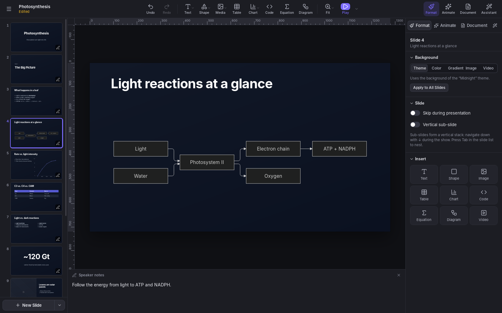

# Cadenza

 [](https://github.com/rodolfo-viana/cadenza/releases) [](https://github.com/rodolfo-viana/cadenza/releases) [](https://github.com/rodolfo-viana/cadenza)


**Presentations, powered by reveal.js.** Cadenza is a desktop presentation app in the spirit of
Keynote and PowerPoint, built on the [reveal.js](https://revealjs.com) engine, written in Rust
with [Tauri](https://tauri.app). It runs on Linux and Windows.



## Features

**Editing**
- Slides built from 12 layouts (title, section, two columns, quote, big number, code…), with text,
  shapes, images, video, tables, charts, code, equations and diagrams.
- Charts edited in a data grid and rendered as crisp SVG: column, bar and area (stacked or not), line, dot plot, streamgraph, pie, donut, treemap, parliament, scatterplot, heatmap, candlestick, Sankey diagram, network graph and maps (the world, a continent, or a country's states or provinces).
- Charts from data: paste cells from a spreadsheet or open a CSV file, see every chart the data can make, and insert one.
- Error bars (±, − and + amounts, or lower and upper ends), value axes with ends of your own, axis titles, reference lines and point shapes.
- Code blocks with syntax highlighting, line numbers and step-by-step line highlights.
- LaTeX math with KaTeX, as equation objects or inline in any text: `$e^{i\pi}+1=0$`.
- [Mermaid](https://mermaid.js.org) diagrams: flowcharts, sequences, timelines, mind maps and more.
- Rulers, draggable guides, smart guides and a snapping grid.
- Undo/redo for everything, a command palette (Ctrl+K) and keyboard shortcuts for all
  common actions.

**Design**
- 22 themes: 8 made for Cadenza plus the classic reveal.js themes.
- A Theme Builder to make your own and share it as a `.cadenza-theme` file (fonts included) or export
  it as reveal.js CSS.
- Google Fonts: every family is searchable offline, and the fonts you pick are embedded in the
  presentation, so it looks the same on any computer.
- Builds (step-by-step animations), slide transitions and Magic Move (reveal.js auto-animate).
- Per-presentation custom CSS for anything else.

**Media**
- A Media Library with openly licensed photos and GIFs from Openverse and Wikimedia Commons, plus
  Pexels, Pixabay and GIPHY with a free API key.
- Images from a link: paste the address of an image, a Wikimedia Commons or Wikipedia file (its
  author and license come along) or a web page (its preview image) in the photo search.
- YouTube and Vimeo videos: browse the sites as usual and click **Insert**, or paste a link. No key
  needed.

**Presenting and sharing**
- Fullscreen show with a presenter display: speaker notes, timer, clock and the next slide.
- A teleprompter in the presenter display that scrolls each slide's speaker notes as you present. Move
  and resize it anywhere, and set its speed, font, size and colors. The audience never sees it.
- With one screen, press X during the show to switch between the slides and the presenter display.
  In a video call, share only the presentation window.
- Vertical sub-slides, skipped slides and auto-advance.
- Export to a web page, either as a folder for any web server or as a single self-contained `.html`
  file, or print to PDF.
- Import reveal.js-style Markdown.
- Crash recovery for unsaved work.
- Updates: when a new version is out, Cadenza offers to download and install it in place of the old
  one, then restarts and reopens your presentations.

**Languages**

The interface is available in Arabic, Bengali, Chinese (Simplified), Dutch, English, French, German,
Hindi, Italian, Japanese, Polish, Portuguese, Portuguese (Brazil), Russian, Spanish and
Turkish. English is the default; change it in **Settings > Language**.

## Download

Installers are published on the [Releases](https://github.com/rodolfo-viana/cadenza/releases) page.

| Platform | File | Notes |
| --- | --- | --- |
| Debian, Ubuntu and derivatives | `Cadenza_x.y.z_amd64.deb` | `sudo apt install ./Cadenza_x.y.z_amd64.deb` |
| Fedora, openSUSE | `Cadenza-x.y.z-1.x86_64.rpm` | `sudo dnf install ./Cadenza-x.y.z-1.x86_64.rpm` (Fedora) or `sudo zypper install ./…` (openSUSE) |
| Any Linux | `Cadenza_x.y.z_amd64.AppImage` | Make it executable and run it; it includes everything it needs |
| Windows 10 and 11 | `Cadenza_x.y.z_x64-setup.exe` or `.msi` | Installs Microsoft WebView2 if it's missing |

> The `.deb` and `.rpm` packages need WebKitGTK 4.1 (Ubuntu 22.04, Debian 12, Fedora 37 or newer).
> 
> The installers aren't code-signed yet, so the first time you run Cadenza on Windows, SmartScreen may ask you to confirm (**More info > Run anyway**).

Once installed, Cadenza keeps itself up to date: when it starts, it looks for a newer version and
offers to install it with the same kind of package (on Linux, the `.deb` and `.rpm` updates ask for
your password). Versions up to 0.3.2 can't do this yet, so install the next one by hand.

Note: *There is no macOS version any longer. Versions 0.2.0 to 0.3.2 had one, but it could not be properly tested on a Mac on regular basis, so it is no longer made.*

## Privacy

Cadenza works fully offline. Online features — Google Fonts downloads, the Media Library and video
previews — contact a service only when you use them. The one exception is the check for updates:
when Cadenza starts, it downloads a small file from GitHub naming the latest version, and sends
nothing about you or your presentations. Turn it off in **Settings > Updates**. API keys are stored in your system's credential
store (Secret Service on Linux, Credential Manager on Windows) and are never saved
inside presentations.

## Files

- **`.cadenza`**: a presentation, stored as a zip archive with `deck.json` and the media and fonts it
  uses.
- **`.cadenza-theme`**: a theme from the Theme Builder (JSON, with its fonts embedded).

## Building from source

You need Rust 1.90 or newer ([rustup](https://rustup.rs)) and the system libraries Tauri uses. On
Debian or Ubuntu:

```sh
sudo apt install build-essential libwebkit2gtk-4.1-dev librsvg2-dev
```

For other systems, see Tauri's [prerequisites](https://v2.tauri.app/start/prerequisites/). Then:

```sh
git clone git@github.com:rodolfo-viana/cadenza.git
cd cadenza/src-tauri
cargo run            # start Cadenza (debug build)
cargo test --lib     # run the tests
```

The interface (`ui/`) is plain HTML, CSS and JavaScript modules with no build step; it is embedded
into the app when Rust compiles it.

To build the installers for your platform (requires Node.js 18 or newer), run from the repository
root:

```sh
npx @tauri-apps/cli@2 build
```

The packages are written to `src-tauri/target/release/bundle/`. Pushing a version tag such as
`v0.2.0` makes GitHub Actions build the Linux and Windows installers and attach them to a draft
release.

## Contributing

Bug reports, translations and code are welcome. See [CONTRIBUTING.md](CONTRIBUTING.md) for how the
project is organized and how to send changes.

## License

Cadenza is released under the [MIT License](LICENSE). It includes reveal.js, KaTeX, Mermaid,
highlight.js, Preact, htm and Lucide icons, each under its own license; see the `LICENSE` files in
[`ui/vendor`](ui/vendor) and [`ui/vendor/licenses`](ui/vendor/licenses). Map charts use boundaries
from [Natural Earth](https://www.naturalearthdata.com) (public domain).
